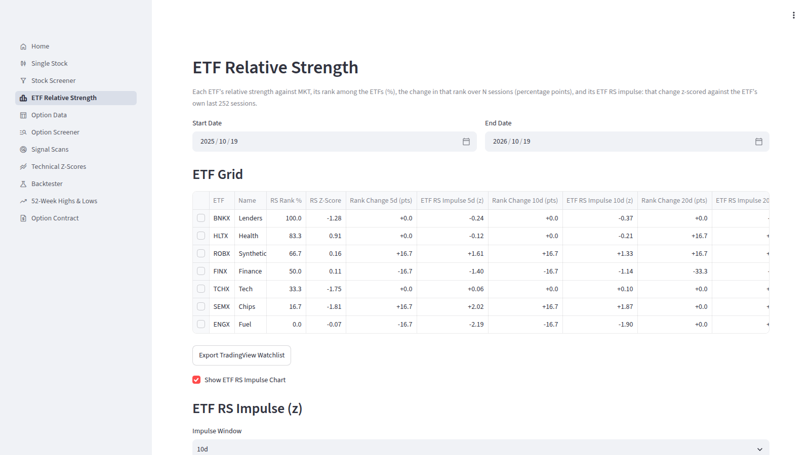
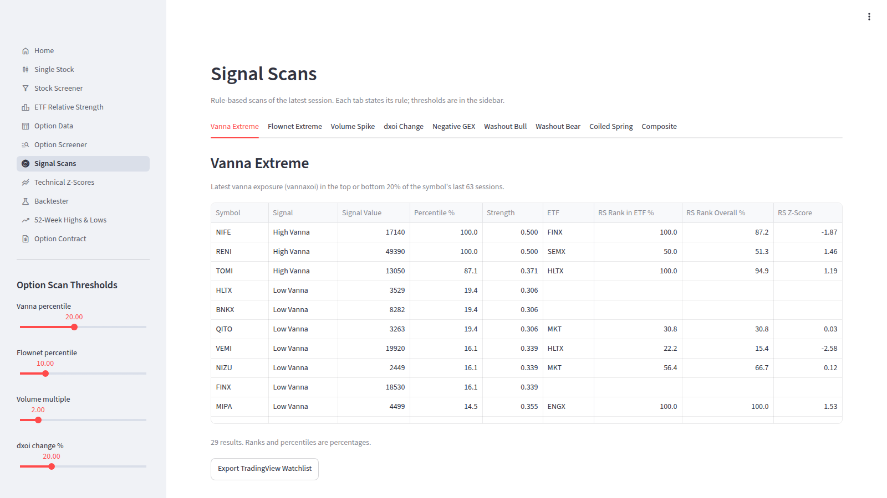
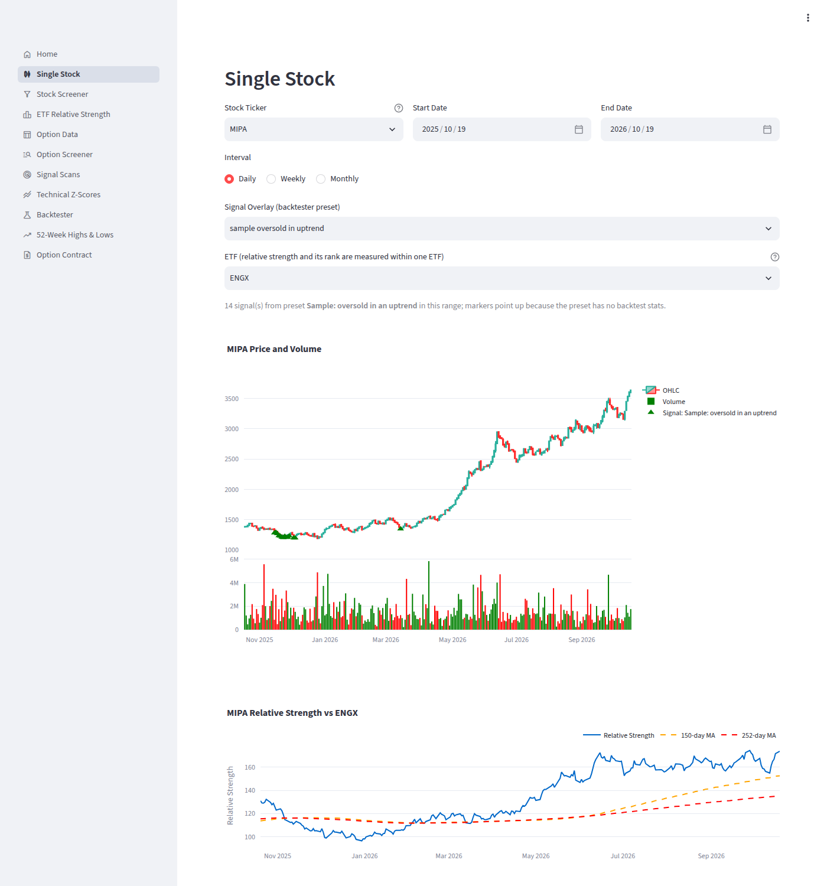
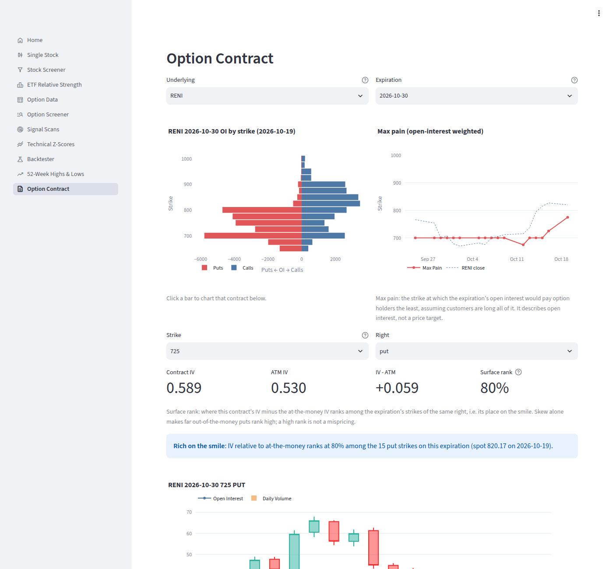
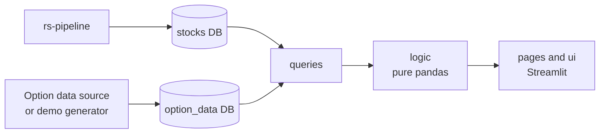

# stock-dashboard

[](https://github.com/scottmcghee/stock-dashboard/actions/workflows/ci.yml)


A Streamlit dashboard for screening stocks by relative strength (RS: a
stock's performance against its ETF, ranked across the universe), technical
indicators and option positioning. It reads the RS rankings that
[rs-pipeline](https://github.com/scottmcghee/rs-pipeline) stores in
PostgreSQL and, optionally, a second database of daily option-chain data.
On top of them it offers a multi-stage stock screener, ETF rankings,
option-positioning and trend scans, chart-pattern detection, and a
backtester that replays screener filters over history and tests their
forward returns with a false-discovery-rate correction.

*Python 3.12+, Streamlit, pandas, Plotly, PostgreSQL, Docker. Unit tests,
plus integration and page tests against a real PostgreSQL seeded with
rs-pipeline's demo market.*



| Signal scans | Single stock with a preset overlay |
|---|---|
|  |  |



## Design highlights

- **"Latest" means the newest data, not today.** Every "latest" query anchors
  on `MAX(date)` of the table it reads, so the pages show the same thing
  whether the data ends today or last month.
- **Look-backs are counted in trading bars.** Each indicator declares how many
  bars it needs, and queries fetch that many rows per ticker, so an indicator
  is never silently undefined at the latest bar.
- **One definition of each indicator.** The scans, the backtester and the
  chart overlay call the same functions (Wilder RSI, a 20-session volume
  z-score, ...); the two screener filters that differ are listed in
  [DESIGN.md](docs/DESIGN.md#invariants). A preset saved from the backtester
  marks the bars on a chart where its filters pass, within its regime,
  computed as the backtest computed them.
- **A backtester that states its limits.** It applies a Benjamini-Hochberg
  correction across every test, and the page summarizes the method's
  weaknesses: overlapping forward windows, close-to-close entry, survivorship
  and in-sample thresholds. See [DESIGN.md](docs/DESIGN.md#backtester).
- **Option data is optional.** A vendor-neutral
  [data contract](docs/DATA_CONTRACT.md) defines the option tables. Without
  them, the pages that need option data say so, and the rest work as usual.
- **A self-contained demo.** No market-data feed or API keys: the demo runs
  rs-pipeline over its fictional market and generates option data from those
  prices, with planted events so that every option scan has something to
  show (the first build downloads images and packages).

## Try it in one command

You need Docker:

```bash
git clone https://github.com/scottmcghee/stock-dashboard.git && cd stock-dashboard
docker compose up --build
```

Then open http://localhost:8501. The first start builds two images, one of
them rs-pipeline's, and takes about 5–10 minutes. The demo contains:

- **Stocks database**, filled by rs-pipeline's own demo: 40 fictional stocks,
  the benchmark `MKT`, sector ETFs (`TCHX`, `FINX`, `HLTX`, `ENGX`), industry
  ETFs (`SEMX`, `BNKX`) and a thematic ETF (`ROBX`), with prices, RS metrics
  and rankings from January 2022 to the last completed trading session. Some
  generated tickers coincide with real symbols, but all of the data is
  fictional.
- **Option database**, generated from those prices: option chains,
  per-underlying aggregates and their 30-session averages for the last 260
  sessions. A few symbols carry planted events, most on the latest session:
  vanna and flownet extremes, a volume spike, a jump in dealer delta exposure
  (dxoi) and negative gamma exposure, so every option scan returns rows. See
  [DATA_CONTRACT.md](docs/DATA_CONTRACT.md#demo-data).

Afterwards:

```bash
docker compose up                              # later runs bring the data up to the latest session
psql -h localhost -p 54321 -U postgres stocks  # password: demo (DEMO_DB_PORT changes the port)
docker compose down -v                         # remove the containers and the demo databases
```

`DEMO_APP_PORT` changes the dashboard's port.

## Pages

| Page | Purpose |
|---|---|
| Single Stock | Price, volume and relative strength of one stock, with an optional preset overlay |
| Stock Screener | Filter stocks by RS, volume, technicals, events, patterns and option metrics |
| ETF Relative Strength | Rank ETFs by relative strength against the benchmark, with the change in rank |
| Option Data | One underlying's option metrics against their 30-session averages |
| Option Screener | Underlyings whose latest value of an option metric is at least N times its average |
| Signal Scans | Option-positioning and trend-readiness scans, plus a composite |
| Technical Z-Scores | RSI, momentum and close relative to a moving average, z-scored across a universe |
| Backtester | Replay filter combinations over history and test their forward returns |
| 52-Week Highs & Lows | Market breadth from new 52-week highs and lows |
| Option Contract | Open interest by strike, max pain and one contract's price history |

Option Data, Option Screener and Option Contract need the option database.
The Stock Screener and Signal Scans hide their option parts without it. Pages
that list symbols can export them as a TradingView watchlist.

## How it works



rs-pipeline owns the stocks schema: prices, ETF memberships, and RS metrics
and ranks for each (stock, ETF) pair. The dashboard only reads it. The option
database follows [docs/DATA_CONTRACT.md](docs/DATA_CONTRACT.md). `queries/`
turns SQL into DataFrames, `logic/` holds the calculations as pure functions,
and the pages are thin Streamlit scripts over both. See
[docs/ARCHITECTURE.md](docs/ARCHITECTURE.md).

## Running against your own databases

You need a stocks database that rs-pipeline maintains. The option database
is optional.

```bash
uv sync                        # Python 3.12+
cp .env.example .env           # set the POSTGRES_* settings and BENCHMARK_TICKER
uv run --env-file .env stock-dashboard
```

`stock-dashboard` starts Streamlit on port 8501 and passes any extra
arguments on to it (for example `--server.port 8600`).

All configuration comes from environment variables; see
[.env.example](.env.example).

| Variable | Default | Purpose |
|---|---|---|
| `POSTGRES_HOST`, `POSTGRES_PORT`, `POSTGRES_USER`, `POSTGRES_PASSWORD` | `localhost`, `5432`, `postgres`, empty | The PostgreSQL server holding both databases |
| `STOCKS_DB_NAME` | `stocks` | The database rs-pipeline writes |
| `OPTION_DB_NAME` | `option_data` | The option database ([contract](docs/DATA_CONTRACT.md)); optional |
| `BENCHMARK_TICKER` | `SPY` | The benchmark that ETF metrics are measured against (rs-pipeline's `RS_REF_TICKER`). The backtester also classifies market regimes from it. |
| `PRESET_DIR` | `~/.config/stock_dashboard/presets` | Where the backtester saves presets |
| `CACHE_DIR` | `~/.cache/stock_dashboard` | The backtester's parquet cache |

`stock-dashboard-seed-demo` fills the option database with **generated**
data, made from the stocks database's closes. It replaces the option rows of
every symbol it generates, so never point it at a database that holds real
option data.

## Development

```bash
uv sync && uv run pre-commit install
uv run pytest                  # everything; the integration tests need Docker
```

See [CONTRIBUTING.md](CONTRIBUTING.md) for the individual checks. CI runs
lint, strict type checks, the tests on Python 3.12, 3.13 and 3.14 with a 90%
coverage floor, a secret scan, and the Docker demo.

## Project layout

```text
src/stock_dashboard/
├── app.py, __main__.py   Streamlit entry point and navigation; the stock-dashboard command
├── config.py, db.py      settings from the environment; connection pools and read_df
├── queries/              SQL to DataFrames, one module per area
├── logic/                indicators, scans, screener, backtest (pure functions)
├── ui/                   Streamlit components shared by pages
├── views/                one script per page
├── demo/                 option-data generator and stock-dashboard-seed-demo
├── schema/               option_data.sql, the contract DDL
└── presets/              sample backtester presets
research/                 research studies (see research/README.md)
tests/
├── unit/                 no database
└── integration/          PostgreSQL in Docker, seeded like the demo; page tests
docs/                     architecture, design, requirements, data contract
```

## Documentation

- [docs/ARCHITECTURE.md](docs/ARCHITECTURE.md): modules, request flow, databases, demo topology, testing
- [docs/DESIGN.md](docs/DESIGN.md): definitions, invariants and design decisions, including the backtester's method and limits
- [docs/REQUIREMENTS.md](docs/REQUIREMENTS.md): functional and nonfunctional requirements, each linked to its tests
- [docs/DATA_CONTRACT.md](docs/DATA_CONTRACT.md): the option tables, their units and sign conventions, and the demo generator
- [research/README.md](research/README.md): the research scripts' methods and caveats

## Limitations

- **Not investment advice.** The scans and the backtester describe historical
  data. Backtest results are in-sample, and their p-values are optimistic
  (see [DESIGN.md](docs/DESIGN.md#backtester)).
- **One snapshot per session.** Option data is an end-of-day snapshot; there
  is no intraday view.
- **Exposure signs are a convention.** The exposure columns (`*xoi`: dealer
  gamma, delta, vanna, ... exposure) assume dealers are long the calls and
  short the puts. That is a model, not an observed position.
- **Survivorship.** The universe and ETF memberships are whatever the stocks
  database holds today, as rs-pipeline's
  [limitations](https://github.com/scottmcghee/rs-pipeline#limitations)
  describe.
- **Single user, no login.** The dashboard has no authentication. Run it on a
  trusted network, or behind a proxy that adds it.

## License

[MIT](LICENSE)
