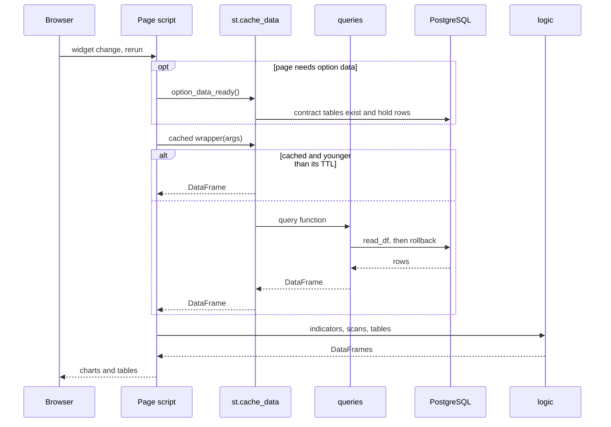
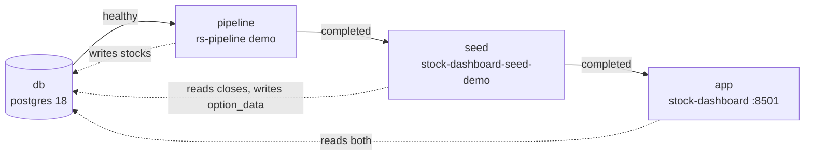

# Architecture

## Modules

```text
src/stock_dashboard/
├── app.py              st.navigation over the pages, run inside the database error boundary
├── __main__.py         stock-dashboard: streamlit run app.py, passing extra arguments on
├── config.py           Settings from environment variables; st.cache_data lifetimes
├── db.py               one thread-safe pool per database, read_df, option_data_available
├── queries/            SQL to DataFrames (no Streamlit)
│   ├── stocks_queries.py          OHLCV (one fetcher, bar-counted windows), RS metrics, ETF grid, screener search
│   ├── screener_queries.py        screener pre-filters (ETF RS, option volume, weeklies, scans), option columns
│   ├── signal_queries.py          option-scan history fetch and the five option scans
│   ├── option_queries.py          underlying_data and its averages; the column whitelist
│   ├── option_contract_queries.py option_chain_data: expirations, OI by strike, contract OHLC
│   └── backtest_queries.py        full-history loads for the backtester, cached as parquet
├── logic/              pure functions over DataFrames (no database, no Streamlit)
│   ├── technical.py        the shared indicators (SMA, Wilder RSI, MACD, volume z, ADR, momentum,
│   │                       ratio to MA, pivot proximity), the screener's TA filters, z-score table
│   ├── events.py           crossing events (RSI, MACD, 200-bar MA, breakout), held for 3 bars
│   ├── patterns.py         five chart-pattern detectors, at the latest bar or at every bar
│   ├── weinstein.py        Weinstein stage classification
│   ├── trend_signals.py    washout and coiled-spring scans
│   ├── option_signals.py   option-positioning scans over a per-symbol history
│   ├── signal_scanner.py   the weighted composite of per-scan strength ranks
│   ├── scan_settings.py    scan thresholds as the scans page enters them; one-line rule per scan
│   ├── screener.py         pre-filter intersection, TA filter inputs, the result grid
│   ├── lookback.py         how many bars each consumer must fetch
│   ├── backtest.py         regimes, indicator panel, forward returns, strategy grid, t-tests, BH
│   ├── backtest_report.py  backtest results as tables, regime blocks and presets
│   ├── preset.py           preset format, sample and user directories, safe file names
│   ├── preset_signal.py    a preset replayed on one ticker's bars (the chart overlay)
│   ├── preset_display.py   a preset described in words
│   ├── chart_helpers.py    resampling, RS moving averages, ETF impulse, 52-week highs and lows
│   ├── export.py           TradingView watchlist text
│   └── max_pain.py, richness.py, option_views.py   option-contract page calculations
├── ui/                 Streamlit components shared by pages
│   ├── option_guard.py     graceful degradation without option data
│   ├── errors.py           the database error boundary app.py runs every page in
│   ├── export.py           the TradingView download button
│   ├── presets.py          the preset picker and loader; the benchmark's regimes for presets
│   ├── tables.py           st.dataframe with readable labels and formats; selection keys
│   └── charts.py           the RS chart; the legend placement the charts share
├── views/              one script per page (1_single_stock.py ... 10_option_contract.py)
├── demo/               demo option data
│   ├── options.py          deterministic generator: chains, aggregates, averages, planted events
│   ├── bsm.py              Black-Scholes-Merton prices and greeks
│   ├── contract.py         the contract's tables and column types, for the generator and the loader
│   ├── load.py             read closes from the stocks DB; write the option tables with COPY
│   └── __main__.py         stock-dashboard-seed-demo
├── schema/option_data.sql  the option-data contract DDL (idempotent)
└── presets/            sample presets, shipped with the package
```

Imports point one way: `views` → `ui` → `queries` → `db`, `config`, and
everything may use `logic`. `logic` imports nothing else from the package
except `config`: `preset.py` reads `PRESET_DIR`, and `preset_display.py` the
link to the docs on GitHub. `queries/option_queries.py` also reads the
contract's column registry (`demo/contract.py`). Only the entry points
(`app.py`, `__main__.py`), `views` and `ui` import Streamlit. `research/`
uses the same `db`, `queries` and `logic` modules; nothing in the package
imports it.

## A page render

Streamlit runs `app.py` on every interaction, and `st.navigation` runs the
selected page script inside it.



Pages wrap each query in `st.cache_data`, keyed by its arguments and shared
by all sessions, with one of three lifetimes from `config.py`:

| Constant | TTL | Used for |
|---|---|---|
| `CACHE_TTL_SHORT` | 60 s | dropdown lists, metadata, the option-data check |
| `CACHE_TTL_DEFAULT` | 300 s | OHLCV, metrics, scans |
| `CACHE_TTL_LONG` | 900 s | the ETF grid and impulse, 52-week highs and lows |

The backtester's full-history loads are cached on disk instead, as parquet
files in `CACHE_DIR` that are reused for 24 hours. Their key includes the
database host, port and name and the benchmark, so the demo and a real
database never share a cache file.

`db.read_df` lends a connection from the database's pool, runs the query,
and rolls back before returning, so no connection sits idle in a
transaction between reruns. The pool keeps no idle connections
(`minconn=0`), so every query opens a fresh connection, and a connection the
server dropped while the app was idle is never reused.
NUMERIC values arrive as floats and dates as pandas datetimes. If a page
can't connect to the database server, `app.py` (through
`ui.errors.database_errors`) shows which host and port it tried, above the
error, instead of a bare traceback; if a table is missing, it says to run
rs-pipeline first.

## Databases

Both databases live on one PostgreSQL server (`POSTGRES_*`). The dashboard
only reads them; the demo seeder is the only writer, and only to the option
database.

### stocks (owned by rs-pipeline)

rs-pipeline creates and fills this schema; see its
[architecture](https://github.com/scottmcghee/rs-pipeline/blob/main/docs/ARCHITECTURE.md).
The dashboard reads these tables and columns:

| Table | Columns read | Read by |
|---|---|---|
| `fact_commons_ohlc` | date, ticker, open, high, low, close, volume | stock charts, screener TA, scans, backtester, 52-week page, demo seeder |
| `fact_index_ohlc` | the same | ETF and benchmark bars: ETF trend scans, regimes, 52-week page, demo seeder |
| `fact_stock_metrics` | date, ticker, etf_ticker, relative_strength, rs_rank_index, rs_rank_overall, rs_z_score | single stock, screener, RS enrichment of scans, backtester |
| `fact_etf_metrics` | date, etf_ticker, ref_ticker, relative_strength, rs_rank_index, rs_rank_overall, rs_z_score | ETF page, screener's ETF pre-filter; always filtered to `ref_ticker = BENCHMARK_TICKER` |
| `dim_stock` | ticker, exchange (and sector, in `research/`) | ticker lists, TradingView exchange prefixes |
| `dim_etf` | etf_ticker, etf_name | ETF names, known symbols |
| `dim_sector`, `dim_industry` | name, etf_ticker | ETF names, known symbols |

### option_data (the contract)

Three tables, defined in [DATA_CONTRACT.md](DATA_CONTRACT.md) and created by
`schema/option_data.sql`. A provider's database may hold more columns.

| Table | Read by |
|---|---|
| `underlying_data` | `option_queries` (pages 4 and 5), `signal_queries` (page 6 and the screener's scan pre-filter), `screener_queries` (volume pre-filter and option columns) |
| `underlying_data_avg` | `option_queries`, `screener_queries`: always joined on the same symbol and date |
| `option_chain_data` | `option_contract_queries` (Option Contract), `screener_queries` (weekly-expirations pre-filter) |

`db.option_data_available()` checks that the three tables exist, and
`ui.option_guard.option_data_ready()` also checks that `underlying_data`
holds rows. Pages consult the cached result; see
[DESIGN.md](DESIGN.md#graceful-degradation).

## The demo



`docker compose up` starts four services in order, each waiting for the
previous one:

1. **db**: `postgres:18-alpine`, pinned by digest, with the data in the
   `pgdata18` volume. Its healthcheck runs `pg_isready` over TCP
   (`-h 127.0.0.1`). During first-time setup the image runs a temporary
   server that listens on the Unix socket only; a socket check would report
   that server as ready, and the pipeline would then be refused when it
   connects over the network.
2. **pipeline**: rs-pipeline, built from its GitHub repository at a pinned
   commit, runs its `demo` command, which needs no market-data feed (`RS_SOURCE=synthetic`, benchmark
   `MKT`, history from 2022-01-03) and fills `stocks`.
3. **seed**: this project's image runs `stock-dashboard-seed-demo`: it
   creates `option_data` if needed, generates option data from the stored
   closes, and replaces the generated symbols' rows.
4. **app**: the same image runs the dashboard with `BENCHMARK_TICKER=MKT`. Its
   healthcheck polls Streamlit's `/_stcore/health`.

Both published ports bind to 127.0.0.1 only. The dashboard image is a
two-stage build on a digest-pinned `python:3.14-slim`; it runs as a non-root
user, and the installed code is owned by root, so that user can't modify it.
Running `docker compose up` again re-runs the pipeline and the seeder, which
brings both databases up to the latest completed session.

## Testing

| Layer | Where | Needs | What it shows |
|---|---|---|---|
| Unit | `tests/unit` | nothing | Indicator, scan, screener and backtest math; query SQL and bound parameters (with `read_df` faked); settings; presets and their file handling; the demo generator's model and planted events; the Streamlit components |
| Integration | `tests/integration/test_demo_data.py`, `test_research.py` | Docker | Real SQL against the seeded demo: latest dates agree, one ETF-grid row per ETF, every option scan finds its planted symbol; each research script runs end to end |
| Page | `tests/integration/test_pages.py` | Docker | Every page renders under Streamlit's `AppTest`, its main interaction works on the demo data, and the option pages degrade without option data |
| Demo | CI `docker` job | Docker | A clean checkout builds, seeds and serves a healthy app, and every page renders without an error inside the image |

The integration and page tests share one session-scoped PostgreSQL 18
container, seeded the same way as the demo (rs-pipeline's demo, then this
project's generator). CI runs every layer; see
[CONTRIBUTING.md](../CONTRIBUTING.md).

## Configuration

Every setting is an environment variable, read once per process by
`config.get_settings()`.

| Variable | Default | Meaning |
|---|---|---|
| `POSTGRES_HOST` | `localhost` | PostgreSQL host for both databases |
| `POSTGRES_PORT` | `5432` | Port |
| `POSTGRES_USER` | `postgres` | User |
| `POSTGRES_PASSWORD` | empty | Password; never shown in `repr` or logs |
| `STOCKS_DB_NAME` | `stocks` | The rs-pipeline database |
| `OPTION_DB_NAME` | `option_data` | The option-data database (optional) |
| `BENCHMARK_TICKER` | `SPY` | The `ref_ticker` of the ETF metrics to show, and the backtester's regime source; upper-cased, an empty value falls back to the default |
| `PRESET_DIR` | `~/.config/stock_dashboard/presets` | User presets: the backtester and `research/ta_signal_analysis.py` write here |
| `CACHE_DIR` | `~/.cache/stock_dashboard` | The backtester's parquet cache |

The image also sets Streamlit's own `STREAMLIT_*` variables (headless, no
usage statistics). The compose file reads `DEMO_DB_PORT` (default 54321) and
`DEMO_APP_PORT` (default 8501) for the published ports.
